# ✈️ TravelWise - Smart Interactive Travel Companion

<p align="center">
  
  
  
  
  
  <a href="https://polman-bandung.ac.id/"></a>
  
</p>

**TravelWise** adalah aplikasi web asisten perjalanan cerdas yang dirancang untuk mempermudah wisatawan merencanakan liburan secara komprehensif. Cukup dengan memasukkan nama negara atau kota tujuan serta memilih tingkatan anggaran (*tier budget*), TravelWise secara otomatis mengintegrasikan data profil negara, kondisi cuaca *real-time*, kurasi tempat wisata nyata dari peta OpenStreetMap, foto destinasi resolusi tinggi, serta kalkulasi estimasi pengeluaran harian multi-mata uang.

---

##  Informasi Proyek & Anggota Tim

- **Politeknik Manufaktur Bandung**
- **Jurusan**: Teknik Otomasi Manufaktur dan Mekatronika
- **Program Studi**: Teknologi Rekayasa Informatika Industri
- **Kelas**: 2 AEC-1
- **Semester**: Ganjil 2026/2027 (Semester 3)
- **Mata Kuliah**: Pemrograman Berorientasi Objek (PBO) Minggu 2
- **Kelompok**: Kelompok 1

###  Daftar Anggota Kelompok:

| No | Nama Anggota | NIM | GitHub |
|:---:|:---|:---:|:---:|
| 1 | **Abdul Majid** | 225443001 | [@Figliaaa](https://github.com/Figliaaa) |
| 2 | **Arya Tirta** | 225443005 | [@225443005-art](https://github.com/225443005-art) |
| 3 | **Farhan Maulana** | 225443008 | [@Dragon-Asce](https://github.com/Dragon-Asce) |
| 4 | **Kiyoshi Oloan Raphael Sitorus** | 225443012 | [@Yosh-22](https://github.com/Yosh-22) |
| 5 | **Muhammad Ihsan Juliansah** | 225443017 | [@ijul212](https://github.com/ijul212) |


---
## 🌟 Fitur Utama

- 🔍 **Pencarian Cerdas & Toleran Bahasa**:
  - Mendukung pencarian berdasarkan nama negara maupun nama kota spesifik.
  - Dilengkapi kamus alias lokal (*offline fallback*) untuk mengenali nama negara dalam Bahasa Indonesia (misal: *Jepang, Amerika Serikat, Jerman, Inggris, Tiongkok*, dll.).
- 🌦️ **Cuaca Real-Time & Rekomendasi Adaptif**:
  - Mengambil kondisi cuaca terkini (suhu, kelembapan, angin, deskripsi cuaca) menggunakan **OpenWeatherMap API**.
  - **Sistem Rekomendasi Cerdas (Penerapan Polimorfisme OOP)**:
    - 🌧️ **Cuaca Hujan/Badai**: Otomatis mengaktifkan rekomendasi tempat *indoor* (museum, galeri seni, kafe lokal, pusat perbelanjaan) lengkap dengan tips menghadapi cuaca buruk.
    - ☀️ **Cuaca Cerah/Kondusif**: Mengaktifkan rekomendasi aktivitas *outdoor* (taman kota, atraksi sejarah terbuka, wisata kuliner street food, spot fotografi).
- 🏛️ **Tempat Wisata Nyata (Point of Interest / POI)**:
  - Mengambil data POI riil di sekitar radius koordinat kota menggunakan **Overpass API (OpenStreetMap)**.
  - Setiap kartu destinasi dilengkapi tautan langsung ke peta interaktif OpenStreetMap.
- 📸 **Visualisasi Destinasi Menawan**:
  - Integrasi **Unsplash API** untuk menampilkan banner kota dan foto tempat wisata.
  - Mekanisme *fallback* dinamis berupa kartu gradien SVG artistik jika API key tidak tersedia atau kuota habis.
- 💰 **Kalkulator Budget Multi-Mata Uang**:
  - 3 Pilihan *Budget Tier*: **Backpacker**, **Moderate**, dan **Luxury**.
  - Menghitung estimasi biaya harian lengkap dengan rincian (*breakdown*) akomodasi, konsumsi, transportasi, dan aktivitas.
  - Konversi otomatis dari USD ke mata uang lokal negara tujuan dan Rupiah (IDR) berdasarkan kurs *real-time* dari **ExchangeRate-API** dengan *caching system* 1 jam.
- ⚡ **Antarmuka Asinkron & Modern**:
  - Desain *Dark Mode Glassmorphism* elegan berbasis **Tailwind CSS**.
  - Interaksi cepat tanpa reload satu halaman penuh berkat **HTMX**.
  - Navigasi cepat dengan keyboard shortcut `Ctrl + K`.

---

## 🏛️ Penerapan Konsep Pemrograman Berorientasi Objek (OOP)

Proyek ini dibangun dengan menerapkan pilar-pilar utama OOP secara konsisten:

```mermaid
classDiagram
    class ApiClient~T~ {
        <<interface>>
        +fetchData(query: String) T?
    }

    class CountryApiClient {
        -baseUrl: String
        -client: HttpClient
        -defaultCountries: Map
        +fetchCountry(name: String) Country?
        +fetchData(query: String) Country?
    }

    class WeatherApiClient {
        -apiKey: String
        -client: HttpClient
        +fetchWeather(cityName: String) WeatherData?
        +fetchData(query: String) WeatherData?
    }

    class OverpassApiClient {
        -baseUrl: String
        -radiusMeters: Int
        +fetchPlaces(lat: Double, lon: Double) List~Place~
        +fetchData(query: String) List~Place~
    }

    class ExchangeRateApiClient {
        -baseUrl: String
        -cache: ConcurrentHashMap
        +getExchangeRate(base: String, target: String) Double?
        +fetchData(query: String) Map~String, Double~?
    }

    class UnsplashApiClient {
        -accessKey: String
        -cache: ConcurrentHashMap
        +fetchImage(query: String, fallback: String) String
        +fetchData(query: String) String?
    }

    ApiClient <|.. CountryApiClient : Implements
    ApiClient <|.. WeatherApiClient : Implements
    ApiClient <|.. OverpassApiClient : Implements
    ApiClient <|.. ExchangeRateApiClient : Implements
    ApiClient <|.. UnsplashApiClient : Implements

    class ActivityRecommender {
        <<interface>>
        +label: String
        +recommend(places: List~Place~, weather: WeatherData) List~Place~
        +activityTips(weather: WeatherData) List~String~
    }

    class IndoorRecommender {
        +label: String = "Aktivitas Indoor"
        +recommend(places: List~Place~, weather: WeatherData) List~Place~
        +activityTips(weather: WeatherData) List~String~
    }

    class OutdoorRecommender {
        +label: String = "Aktivitas Outdoor"
        +recommend(places: List~Place~, weather: WeatherData) List~Place~
        +activityTips(weather: WeatherData) List~String~
    }

    ActivityRecommender <|.. IndoorRecommender : Implements
    ActivityRecommender <|.. OutdoorRecommender : Implements

    class TravelService {
        -countryApiClient: CountryApiClient
        -weatherApiClient: WeatherApiClient
        -exchangeRateApiClient: ExchangeRateApiClient
        -overpassApiClient: OverpassApiClient
        -unsplashApiClient: UnsplashApiClient
        +getTravelPlan(query: String, tier: BudgetTier) TravelPlanResult
        -buildBudget(tier: BudgetTier, country: Country, rates: Map) BudgetPlan
    }

    TravelService --> ActivityRecommender : Uses (Polymorphism)
    TravelService --> CountryApiClient : Injected
    TravelService --> WeatherApiClient : Injected
    TravelService --> ExchangeRateApiClient : Injected
    TravelService --> OverpassApiClient : Injected
    TravelService --> UnsplashApiClient : Injected
```



### 1. Abstraksi (Abstraction)
- **`ApiClient<T>`**: Merupakan kontrak antarmuka (*generic interface*) yang mengabstraksikan operasi pengambilan data dari layanan API eksternal, memisahkan logika komunikasi HTTP dari lapisan logika bisnis (*Service Layer*).
- **`ActivityRecommender`**: Mengabstraksikan mekanisme penentuan rekomendasi tempat dan tips aktivitas liburan tanpa mengikat implementasi spesifik cuaca.

### 2. Polimorfisme (Polymorphism)
- **Rekomendasi Berbasis Cuaca (Strategy Pattern)**:
  `TravelService` menentukan objek rekomendasi secara dinamis saat *runtime* berdasarkan kondisi cuaca:
  ```kotlin
  val isIndoor = weather.isRainyOrStormy()
  val recommender: ActivityRecommender = if (isIndoor) IndoorRecommender() else OutdoorRecommender()
  ```
  Objek `IndoorRecommender` dan `OutdoorRecommender` mengimplementasikan fungsi `recommend()` dan `activityTips()` dengan perilaku kurasi yang berbeda.
- **Implementasi Antarmuka `ApiClient<T>`**:
  Berbagai klien jaringan (`CountryApiClient`, `WeatherApiClient`, `ExchangeRateApiClient`, `OverpassApiClient`, `UnsplashApiClient`) mengimplementasikan metode `fetchData()` sesuai dengan tipe data model masing-masing.

### 3. Enkapsulasi (Encapsulation)
- Variabel konfigurasi sensitif (API keys, endpoint URLs), konfigurasi timeout HTTP, dan cache lokal (`ConcurrentHashMap`) disembunyikan dalam visibilitas `private`.
- Setiap model data (*Data Class*) merepresentasikan entitas spesifik yang *immutable* dan memiliki tanggung jawab internal (contoh: fungsi `weather.isRainyOrStormy()` pada `WeatherData` dan getter `place.mapUrl` pada `Place`).

### 4. Dependency Injection & Separation of Concerns (SoC)
- `TravelService` tidak menginstansiasi API Client secara langsung di dalam metodenya, melainkan menerima seluruh dependensi melalui konstruktor (*Constructor-based Dependency Injection*).
- Pemisahan kode yang jelas antar layer:
  - **`model/`**: Struktur data dan representasi entitas.
  - **`network/`**: Lapisan komunikasi data HTTP dan deserialisasi JSON.
  - **`service/`**: Logika bisnis utama, agregasi asinkron, dan strategi rekomendasi.
  - **`view/`**: Representasi tampilan antarmuka web (Type-Safe HTML DSL & Tailwind CSS).
  - **`plugins/`**: Konfigurasi routing server Ktor dan serialisasi.

---

## 🛠️ Arsitektur Teknologi & Library

| Komponen | Teknologi | Deskripsi |
| :--- | :--- | :--- |
| **Language** | Kotlin `1.9.22` (JVM 17) | Bahasa pemrograman utama berparadigma OOP modern |
| **Server Engine** | Ktor Server `2.3.8` (Netty) | Framework mikro-server asynchronous berkinerja tinggi |
| **HTTP Client** | Ktor Client `2.3.8` (CIO Engine) | Klien HTTP non-blocking berbasis Kotlin Coroutines |
| **Serialization** | Kotlinx Serialization `1.6.2` | Pustaka parsing dan manipulasi payload JSON |
| **UI Templating** | Ktor HTML Builder DSL | Pembangun komponen HTML type-safe tanpa file template eksternal |
| **Frontend Style** | Tailwind CSS (CDN) | Framework utility-first CSS dengan desain glassmorphism & dark theme |
| **Interactivity** | HTMX `1.9.10` | Library SPA-like untuk AJAX request & DOM swap asinkron |
| **Logging** | Logback Classic `1.4.14` | Framework logging terintegrasi SLF4J |
| **Deployment** | Docker & Docker Compose | Multi-stage containerization berbasis JDK 17 & Temurin Alpine JRE |

---

## 🌐 Layanan Public API yang Digunakan

1. **[REST Countries API](https://restcountries.com/)**: Mengambil data resmi negara, ibu kota, populasi, kode mata uang, dan bendera nasional.
2. **[OpenWeatherMap API](https://openweathermap.org/api)**: Mengambil data cuaca real-time, temperatur celcius, kelembapan udara, kecepatan angin, serta koordinat bumi (latitude & longitude).
3. **[ExchangeRate-API](https://open.er-api.com/)**: Mengambil data kurs valuta asing terkini untuk konversi nilai tukar ke mata uang lokal dan IDR.
4. **[Overpass API (OpenStreetMap)](https://overpass-api.de/)**: Mengambil data Point of Interest (POI) nyata di sekitar kota tujuan (museum, kafe, taman, monumen bersejarah, dll.).
5. **[Unsplash API](https://unsplash.com/developers)**: Mengambil foto pemandangan kota dan tempat wisata.

---

## 📁 Struktur Direktori Proyek

```text
TravelWise/
├── .env.sample                      # Template konfigurasi environment variables
├── build.gradle.kts                 # Skrip build Gradle & dependensi proyek
├── settings.gradle.kts              # Konfigurasi nama modul proyek
├── Dockerfile                       # Multi-stage Docker build file
├── docker-compose.yml               # Konfigurasi orkestrasi container Docker
├── CONTRIBUTING.md                  # Panduan kontribusi tim & Git Flow
├── SECURITY.md                      # Panduan pelaporan celah keamanan
├── LICENSE                          # Lisensi proyek (MIT License)
├── README.md                        # Dokumentasi utama proyek
└── src/
    └── main/
        ├── resources/
        │   ├── application.conf     # Konfigurasi server Ktor & endpoint API
        │   └── logback.xml          # Konfigurasi logback (opsional)
        └── kotlin/
            └── com/travelwise/
                ├── Application.kt   # Entry point aplikasi & inisialisasi modul Ktor
                ├── model/           # Lapisan Data Model
                │   ├── BudgetPlan.kt       # Model tier, breakdown, dan kalkulasi budget
                │   ├── Country.kt          # Model representasi profil negara
                │   ├── Place.kt            # Model POI tempat wisata & URL OpenStreetMap
                │   ├── ResponseState.kt    # Generic Sealed Class untuk state respons
                │   └── WeatherData.kt      # Model cuaca & logika isRainyOrStormy
                ├── network/         # Lapisan Komunikasi HTTP Eksternal
                │   ├── ApiClient.kt             # Kontrak interface abstraksi ApiClient<T>
                │   ├── CountryApiClient.kt      # Klien REST Countries + fallback kamus
                │   ├── ExchangeRateApiClient.kt # Klien kurs valuta asing + 1-hour cache
                │   ├── HttpClient.kt            # Singleton HTTP Client Ktor CIO Engine
                │   ├── OverpassApiClient.kt     # Klien OpenStreetMap Overpass QL
                │   ├── UnsplashApiClient.kt     # Klien foto Unsplash + SVG generator
                │   └── WeatherApiClient.kt      # Klien cuaca OpenWeatherMap
                ├── service/         # Lapisan Logika Bisnis & Rekomendasi
                │   ├── ActivityRecommender.kt   # Interface strategi rekomendasi & diversifikasi
                │   ├── IndoorRecommender.kt     # Strategi rekomendasi cuaca hujan/indoor
                │   ├── OutdoorRecommender.kt    # Strategi rekomendasi cuaca cerah/outdoor
                │   └── TravelService.kt         # Orkestrasi agregasi paralel & kalkulator budget
                ├── plugins/         # Konfigurasi Ktor Server
                │   ├── Routing.kt          # Definisi endpoint routing (/, /search, /api/search)
                │   └── Serialization.kt    # Konfigurasi serialisasi server
                └── view/            # Tampilan Antarmuka (HTML DSL)
                    ├── HomeView.kt         # Halaman pencarian utama & form HTMX
                    ├── Layout.kt           # Master layout, animasi CSS, & shortcut Ctrl+K
                    └── WeatherWidget.kt    # Komponen kartu hasil profil, cuaca, POI, & budget
```

---

## 🚀 Panduan Memulai & Menjalankan Proyek

### 1. Prasyarat Sistem
Pastikan perangkat Anda telah terpasang:
- **Java Development Kit (JDK)**: Versi 17 atau lebih tinggi.
- **Gradle**: Versi 8.x (atau menggunakan Gradle Wrapper bawaan).
- **Docker & Docker Compose** *(Opsional, jika ingin menjalankan via container)*.

### 2. Kloning Repositori
```bash
git clone https://github.com/Dragon-Asce/TravelWise.git
cd TravelWise
```

### 3. Konfigurasi Environment Variables
Salin file `.env.sample` menjadi `.env`:
```bash
cp .env.sample .env
```
Buka file `.env` dan masukkan API Key yang diperlukan:
```env
# API Key OpenWeatherMap (Wajib untuk data cuaca real-time)
OPENWEATHER_API_KEY=your_openweather_api_key_here

# API Key REST Countries (Opsional, sudah ada offline fallback)
RESTCOUNTRIES_API_KEY=your_restcountries_api_key_here

# API Key Unsplash (Opsional, otomatis menggunakan gradient placeholder jika kosong)
UNSPLASH_API_KEY=your_unsplash_api_key_here
```

> [!TIP]
> Anda bisa mendapatkan API Key gratis untuk cuaca di [OpenWeatherMap](https://home.openweathermap.org/users/sign_up). Jika `UNSPLASH_API_KEY` dikosongkan, aplikasi akan tetap berjalan mulus dengan menghasilkan banner grafis dinamis berbasis SVG gradient.

---

### 4. Menjalankan Aplikasi Secara Lokal

#### Opsi A: Menggunakan Gradle
```bash
# Di Linux/macOS
./gradlew run

# Di Windows (PowerShell/CMD)
.\gradlew.bat run
```

#### Opsi B: Membangun Fat JAR
```bash
# Build Fat JAR
./gradlew buildFatJar

# Jalankan executable JAR
java -jar build/libs/travelwise.jar
```

#### Opsi C: Menggunakan Docker Compose (Direkomendasikan)
Menjalankan seluruh aplikasi dalam kontainer yang terisolasi dan mandiri:
```bash
# Jalankan kontainer di background
docker compose up --build -d

# Memeriksa log aplikasi
docker compose logs -f

# Menghentikan kontainer
docker compose down
```

Setelah aplikasi berjalan, buka peramban (*browser*) Anda dan akses:
👉 **`http://localhost:8080`**

---

## 📌 Endpoint API

| Method | Endpoint | Tipe Request | Deskripsi |
| :--- | :--- | :--- | :--- |
| `GET` | `/` | HTML | Menampilkan halaman utama aplikasi TravelWise |
| `POST` | `/search` | Form / HTMX | Memproses pencarian destinasi dan merender widget hasil |
| `GET` | `/search?country={query}&tier={tier}` | Query Param | Alternatif pencarian via query parameter URL |
| `POST` / `GET` | `/api/search` | Form / Query | Endpoint alternatif untuk integrasi data |

### Parameter Pencarian:
- `country` atau `destination` (*wajib*): Nama negara atau kota (contoh: `Japan`, `Tokyo`, `Bandung`, `Paris`).
- `tier` (*opsional*): Pilihan anggaran perjalanan (`BACKPACKER`, `MODERATE`, `LUXURY`). Standar *default*: `MODERATE`.

---

## 🤝 Kontribusi & Alur Kerja Git

Pengembangan proyek ini mengikuti standar **Git Flow** sederhana:
1. `main`: Branch rilis produksi yang stabil.
2. `develop`: Branch integrasi fitur baru.
3. `feature/<nama-fitur>`: Branch pengembangan untuk setiap penambahan fungsionalitas.

Standar penulisan commit mengacu pada **Conventional Commits**:
- `feat`: Menambahkan fitur baru (contoh: `feat(network): implement WeatherApiClient`)
- `fix`: Memperbaiki bug (contoh: `fix(routing): handle empty query validation`)
- `refactor`: Refaktor struktur kode tanpa merubah fungsi (contoh: `refactor(service): optimize budget calculation`)
- `docs`: Pembaruan dokumentasi (contoh: `docs(readme): add OOP architecture diagram`)

Silakan merujuk ke file [CONTRIBUTING.md](file:///c:/Tugas%20Kuliah/Semester%203/Praktek%20OOP/TravelWise/CONTRIBUTING.md) untuk detail panduan kontribusi selengkapnya.

---

---

## 📄 Lisensi

Proyek ini dilisensikan di bawah lisensi **MIT License** - lihat berkas [LICENSE](LICENSE) untuk informasi selengkapnya.
