# ✈️ TravelWise - Smart Interactive Travel Companion

<p align="center">
  
  
  
  
  
  
  <a href="https://polman-bandung.ac.id/"></a>
  
</p>

**TravelWise** adalah aplikasi web asisten perjalanan cerdas berbasis Kotlin & Ktor yang dirancang untuk mempermudah wisatawan merencanakan liburan secara komprehensif. Cukup dengan memasukkan nama negara atau kota tujuan serta memilih tingkatan anggaran (*budget tier*), TravelWise secara otomatis mengintegrasikan data profil negara, telemetri cuaca *real-time*, deteksi musim aktual, kurasi tempat wisata nyata dari OpenStreetMap (Overpass), visualisasi peta interaktif Leaflet.js dengan layer gelap Stadia Maps, foto destinasi resolusi tinggi dari Unsplash, serta kalkulasi estimasi pengeluaran harian multi-mata uang.

Proyek ini dikembangkan sebagai bagian dari pemenuhan Tugas Praktik **Pemrograman Berorientasi Objek (Object-Oriented Programming / OOP)** Semester 3.

---

## 🎓 Informasi Proyek & Anggota Tim

- **Politeknik Manufaktur Bandung**
- **Jurusan**: Teknik Otomasi Manufaktur dan Mekatronika
- **Program Studi**: Teknologi Rekayasa Informatika Industri
- **Kelas**: 2 AEC-1
- **Semester**: Ganjil 2026/2027 (Semester 3)
- **Mata Kuliah**: Pemrograman Berorientasi Objek (PBO) Minggu 2
- **Kelompok**: Kelompok 1

### 👥 Daftar Anggota Kelompok:

| No | Nama Anggota | NIM | GitHub |
|:---:|:---|:---:|:---:|
| 1 | **Abdul Majid** | 225443001 | [@Figliaaa](https://github.com/Figliaaa) |
| 2 | **Arya Tirta** | 225443005 | [@225443005-art](https://github.com/225443005-art) |
| 3 | **Farhan Maulana** | 225443008 | [@Dragon-Asce](https://github.com/Dragon-Asce) |
| 4 | **Kiyoshi Oloan Raphael Sitorus** | 225443012 | [@Yosh-22](https://github.com/Yosh-22) |
| 5 | **Muhammad Ihsan Juliansah** | 225443017 | [@ijul212](https://github.com/ijul212) |

---

## 🌟 Fitur Utama

- 🔍 **Pencarian Cerdas & Resolusi Kota-ke-Negara (*Smart Geolocation*)**:
  - Mendukung input nama negara (misal: *Japan, Prancis, Indonesia*) maupun kota spesifik (misal: *Tokyo, Paris, Bandung, Bekasi*).
  - Jika pengguna memasukkan nama kota, sistem secara cerdas membaca kode negara ISO 2-huruf (`countryCode`) dari respons cuaca dan mencari data kedaulatan negara melalui endpoint alpha-2.
  - Dilengkapi kamus alias lokal (*offline fallback*) untuk mengenali nama negara dalam Bahasa Indonesia (*Jepang, Amerika Serikat, Jerman, Inggris, Tiongkok, Belanda*, dll.).
- 🌦️ **Cuaca Real-Time & Rekomendasi Adaptif (Polimorfisme OOP)**:
  - Mengambil data telemetri cuaca terkini (suhu °C, kelembapan %, hembusan angin, dan deskripsi langit) via **OpenWeatherMap API**.
  - **Mesin Rekomendasi Adaptif (*Strategy Pattern*)**:
    - 🌧️ **Cuaca Hujan/Badai/Suhu Ekstrem (< 12°C atau > 34°C)**: Otomatis mengaktifkan `IndoorRecommender` (museum, galeri seni, kafe hangat, pusat perbelanjaan) lengkap dengan tips perlengkapan cuaca.
    - ☀️ **Cuaca Cerah/Kondusif**: Mengaktifkan `OutdoorRecommender` (taman kota, atraksi sejarah terbuka, wisata kuliner jalanan, spot fotografi).
- 🧭 **Deteksi Musim Astronomis Aktual (*Seasonal Analysis*)**:
  - Mengalkulasi musim berjalan secara presisi berdasarkan posisi garis lintang bumi (*latitude*) dan kalender bulan:
    - **Daerah Khatulistiwa/Tropis (-10° s/d 10°)**: Musim Kemarau (April–Oktober) vs. Musim Hujan.
    - **Belahan Bumi Utara (> 10°)**: Musim Dingin (*Winter*), Musim Semi (*Spring*), Musim Panas (*Summer*), Musim Gugur (*Autumn*).
    - **Belahan Bumi Selatan (< -10°)**: Kebalikan musim di belahan bumi utara.
- 🗺️ **Radar Telemetri & Peta Interaktif (Leaflet.js & Stadia Maps)**:
  - Visualisasi koordinat kota pada peta interaktif Leaflet.js dengan tile layer gelap premium **Stadia Maps (*Alidade Smooth Dark*)**.
  - Dilengkapi marker kontras merah berkarakter *Swiss Style* dan tautan langsung ke **OpenStreetMap**.
- 🏛️ **Tempat Wisata Nyata (Point of Interest / POI)**:
  - Mengambil data POI riil di sekitar radius 10 km kota menggunakan **Overpass API (OpenStreetMap)**.
  - Algoritma diversifikasi round-robin kategori untuk memastikan hasil variatif dan proporsional.
- 📸 **Visualisasi Destinasi Menawan**:
  - Integrasi **Unsplash API** untuk menyajikan fotografi lanskap kota dan foto tempat wisata.
  - Mekanisme *fallback* dinamis berupa kartu gradien SVG artistik jika API key tidak tersedia atau kuota habis.
- 💰 **Kalkulator Anggaran Multi-Mata Uang**:
  - 3 Pilihan *Budget Tier*: **Backpacker** ($40/hari), **Moderate** ($120/hari), dan **Luxury** ($350/hari).
  - Rincian pos pengeluaran harian: Akomodasi (40%), Makan & Minum (30%), Transportasi (15%), dan Tiket/Aktivitas (15%).
  - Konversi otomatis dari USD ke simbol valuta lokal (¥, $, €, £, Rp) dan Rupiah (IDR) berdasarkan nilai tukar real-time dari **ExchangeRate-API** dengan *caching system* 1 jam.
- 🎨 **Antarmuka Modern Swiss Style & Brutalism**:
  - Desain tipografi internasional berbasis font *Inter*, garis pembatas tegas (*swiss-border*), kontras tinggi monokrom dengan aksen merah Swiss (`#E61919`).
  - Animasi *Ticker Tape* (*System Live Feed*), lapisan tekstur *Noise SVG*, dan transisi HTMX tanpa reload halaman (*Single Page Experience*).
  - Navigasi cepat dengan pintasan papan ketik `Ctrl + K`.
- 📖 **Dokumentasi Kode Komprehensif (KDoc)**:
  - Seluruh berkas pada lapisan model, service, view, network, dan routing telah dilengkapi dokumentasi standar industri **KDoc** lengkap dengan tag `@property`, `@param`, `@return`, dan `@author`.

---

## 🏛️ Penerapan Konsep Pemrograman Berorientasi Objek (OOP)

Proyek ini dirancang secara modular dan menerapkan pilar-pilar utama OOP:

```mermaid
classDiagram
    class ApiClient~T~ {
        <<interface>>
        +fetchData(query: String) T?
    }

    class CountryApiClient {
        -baseUrl: String
        -client: HttpClient
        -defaultCountries: Map
        +fetchCountry(name: String) Country?
        +fetchByAlpha2(code: String) Country?
        +fetchData(query: String) Country?
    }

    class WeatherApiClient {
        -apiKey: String
        -client: HttpClient
        +fetchWeather(cityName: String) WeatherData?
        +fetchData(query: String) WeatherData?
    }

    class OverpassApiClient {
        -baseUrl: String
        -radiusMeters: Int
        +fetchPlaces(lat: Double, lon: Double) List~Place~
        +fetchData(query: String) List~Place~
    }

    class ExchangeRateApiClient {
        -baseUrl: String
        -cache: ConcurrentHashMap
        +getExchangeRate(base: String, target: String) Double?
        +fetchData(query: String) Map~String, Double~?
    }

    class UnsplashApiClient {
        -accessKey: String
        -cache: ConcurrentHashMap
        +fetchImage(query: String, fallback: String) String
        +fetchData(query: String) String?
    }

    ApiClient <|.. CountryApiClient : Implements
    ApiClient <|.. WeatherApiClient : Implements
    ApiClient <|.. OverpassApiClient : Implements
    ApiClient <|.. ExchangeRateApiClient : Implements
    ApiClient <|.. UnsplashApiClient : Implements

    class ActivityRecommender {
        <<interface>>
        +label: String
        +recommend(places: List~Place~, weather: WeatherData) List~Place~
        +activityTips(weather: WeatherData) List~String~
    }

    class IndoorRecommender {
        +label: String = "Aktivitas Indoor"
        +recommend(places: List~Place~, weather: WeatherData) List~Place~
        +activityTips(weather: WeatherData) List~String~
    }

    class OutdoorRecommender {
        +label: String = "Aktivitas Outdoor"
        +recommend(places: List~Place~, weather: WeatherData) List~Place~
        +activityTips(weather: WeatherData) List~String~
    }

    ActivityRecommender <|.. IndoorRecommender : Implements
    ActivityRecommender <|.. OutdoorRecommender : Implements

    class TravelService {
        -countryApiClient: CountryApiClient
        -weatherApiClient: WeatherApiClient
        -exchangeRateApiClient: ExchangeRateApiClient
        -overpassApiClient: OverpassApiClient
        -unsplashApiClient: UnsplashApiClient
        +getTravelPlan(query: String, tier: BudgetTier) TravelPlanResult
        -calculateCurrentSeason(lat: Double?) String
        -buildBudget(tier: BudgetTier, country: Country, rates: Map) BudgetPlan
    }

    TravelService --> ActivityRecommender : Uses Strategy (Polymorphism)
    TravelService --> CountryApiClient : Injected
    TravelService --> WeatherApiClient : Injected
    TravelService --> ExchangeRateApiClient : Injected
    TravelService --> OverpassApiClient : Injected
    TravelService --> UnsplashApiClient : Injected
```



### 1. Abstraksi (Abstraction)
- **`ApiClient<T>`**: Antarmuka generik yang mendefinisikan kontrak komunikasi HTTP eksternal, memisahkan rincian protokol jaringan dari lapisan logika bisnis (*Service Layer*).
- **`ActivityRecommender`**: Mengabstraksikan perilaku rekomendasi tempat dan pembuatan kiat perjalanan tanpa mengikat logika cuaca spesifik.

### 2. Polimorfisme (Polymorphism)
- **Rekomendasi Berbasis Cuaca (*Strategy Pattern*)**:
  `TravelService` memilih strategi kurasi secara dinamis saat *runtime* berdasarkan kondisi cuaca:
  ```kotlin
  val isIndoor = weather.isRainyOrStormy() || isBadWeather || isExtremeTemp
  val recommender: ActivityRecommender = if (isIndoor) IndoorRecommender() else OutdoorRecommender()
  ```
  Objek `IndoorRecommender` dan `OutdoorRecommender` memproses tempat dengan aturan kurasi dan tips yang berbeda.
- **Implementasi Antarmuka `ApiClient<T>`**:
  Berbagai klien jaringan (`CountryApiClient`, `WeatherApiClient`, `ExchangeRateApiClient`, `OverpassApiClient`, `UnsplashApiClient`) mengimplementasikan metode `fetchData()` sesuai tipe domain masing-masing.

### 3. Enkapsulasi (Encapsulation)
- Variabel konfigurasi sensitif (API keys, endpoint URLs), konfigurasi timeout HTTP, dan cache lokal (`ConcurrentHashMap`) disembunyikan dalam visibilitas `private`.
- Setiap model data (*Data Class*) merepresentasikan entitas spesifik yang *immutable* dan memiliki tanggung jawab internal (contoh: fungsi `weather.isRainyOrStormy()` pada `WeatherData` dan properti `place.mapUrl` pada `Place`).

### 4. Dependency Injection & Separation of Concerns (SoC)
- `TravelService` menerima seluruh klien jaringan melalui konstruktor (*Constructor-based Dependency Injection*), mendukung *loose coupling* dan mempermudah unit testing.
- Pemisahan kode yang terstruktur rapi:
  - **`model/`**: Struktur data dan representasi entitas (BudgetPlan, Country, Place, ResponseState, WeatherData).
  - **`network/`**: Lapisan komunikasi data HTTP dan deserialisasi JSON.
  - **`service/`**: Logika bisnis utama, orkestrasi asinkron, dan strategi rekomendasi.
  - **`view/`**: Representasi antarmuka web bergaya Swiss Brutalism (Type-Safe HTML DSL & Tailwind CSS).
  - **`plugins/`**: Konfigurasi routing server Ktor dan serialisasi.

---

## 🛠️ Arsitektur Teknologi & Library

| Komponen | Teknologi | Deskripsi |
| :--- | :--- | :--- |
| **Language** | Kotlin `1.9.22` (JVM 17) | Bahasa pemrograman utama berparadigma OOP modern |
| **Server Engine** | Ktor Server `2.3.8` (Netty) | Framework mikro-server asynchronous berkinerja tinggi |
| **HTTP Client** | Ktor Client `2.3.8` (CIO Engine) | Klien HTTP non-blocking berbasis Kotlin Coroutines |
| **Serialization** | Kotlinx Serialization `1.6.2` | Pustaka parsing dan manipulasi payload JSON |
| **UI Templating** | Ktor HTML Builder DSL | Pembangun komponen HTML type-safe tanpa template eksternal |
| **Frontend Style** | Tailwind CSS (CDN) | Framework utility-first CSS dengan tema Swiss Brutalism |
| **Interactive Map** | Leaflet.js `1.9.4` & Stadia Maps | Peta interaktif dengan tile layer gelap *Alidade Smooth Dark* |
| **Interactivity** | HTMX `1.9.10` | Library SPA-like untuk AJAX request & DOM swap asinkron |
| **Logging** | Logback Classic `1.4.14` | Framework logging terintegrasi SLF4J |
| **Deployment** | Docker & Docker Compose | Multi-stage containerization berbasis JDK 17 & Temurin Alpine JRE |

---

## 🌐 Layanan Public API yang Digunakan

1. **[REST Countries API](https://restcountries.com/)**: Mengambil data kedaulatan negara, ibu kota, populasi, kode mata uang, dan bendera nasional.
2. **[OpenWeatherMap API](https://openweathermap.org/api)**: Mengambil data cuaca real-time, temperatur celcius, kelembapan udara, kecepatan angin, koordinat (latitude & longitude), dan kode negara ISO.
3. **[ExchangeRate-API](https://open.er-api.com/)**: Mengambil data kurs valuta asing terkini untuk konversi nilai tukar ke mata uang lokal dan IDR.
4. **[Overpass API (OpenStreetMap)](https://overpass-api.de/)**: Mengambil data Point of Interest (POI) nyata di sekitar kota tujuan (museum, kafe, taman, monumen bersejarah, dll.).
5. **[Unsplash API](https://unsplash.com/developers)**: Mengambil fotografi lanskap kota dan foto tempat wisata.
6. **[Stadia Maps](https://stadiamaps.com/)**: Menyediakan tile layer peta modern *Alidade Smooth Dark* untuk kontainer peta Leaflet.js.

---

## 📁 Struktur Direktori Proyek

```text
TravelWise/
├── .env.sample                      # Template konfigurasi environment variables
├── build.gradle.kts                 # Skrip build Gradle & dependensi proyek
├── settings.gradle.kts              # Konfigurasi nama modul proyek
├── Dockerfile                       # Multi-stage Docker build file
├── docker-compose.yml               # Konfigurasi orkestrasi container Docker
├── CONTRIBUTING.md                  # Panduan kontribusi tim & Git Flow
├── SECURITY.md                      # Panduan pelaporan celah keamanan
├── LICENSE                          # Lisensi proyek (MIT License)
├── README.md                        # Dokumentasi utama proyek
└── src/
    └── main/
        ├── resources/
        │   ├── application.conf     # Konfigurasi server Ktor & endpoint API
        │   └── logback.xml          # Konfigurasi logback (opsional)
        └── kotlin/
            └── com/travelwise/
                ├── Application.kt   # Entry point aplikasi & inisialisasi modul Ktor [KDoc]
                ├── model/           # Lapisan Data Model [KDoc]
                │   ├── BudgetPlan.kt       # Model tier, breakdown, dan kalkulasi budget
                │   ├── Country.kt          # Model representasi profil kedaulatan negara
                │   ├── Place.kt            # Model POI tempat wisata & URL OpenStreetMap
                │   ├── ResponseState.kt    # Generic Sealed Class untuk state siklus hidup respons
                │   └── WeatherData.kt      # Model telemetri cuaca & logika isRainyOrStormy
                ├── network/         # Lapisan Komunikasi HTTP Eksternal [KDoc]
                │   ├── ApiClient.kt             # Kontrak interface abstraksi ApiClient<T>
                │   ├── CountryApiClient.kt      # Klien REST Countries + fallback kamus + alpha2 lookup
                │   ├── ExchangeRateApiClient.kt # Klien kurs valuta asing + 1-hour in-memory cache
                │   ├── HttpClient.kt            # Singleton HTTP Client Ktor CIO Engine
                │   ├── OverpassApiClient.kt     # Klien OpenStreetMap Overpass QL
                │   ├── UnsplashApiClient.kt     # Klien foto Unsplash + dynamic SVG generator
                │   └── WeatherApiClient.kt      # Klien cuaca OpenWeatherMap (suhu, angin, lat/lon, DTO)
                ├── service/         # Lapisan Logika Bisnis & Rekomendasi [KDoc]
                │   ├── ActivityRecommender.kt   # Interface strategi rekomendasi & diversifikasi
                │   ├── IndoorRecommender.kt     # Strategi rekomendasi aktivitas indoor/cuaca buruk
                │   ├── OutdoorRecommender.kt    # Strategi rekomendasi aktivitas outdoor/cuaca cerah
                │   └── TravelService.kt         # Orkestrasi agregasi paralel, analisis musim, & budget
                ├── plugins/         # Konfigurasi Ktor Server [KDoc]
                │   ├── Routing.kt          # Definisi endpoint routing (/, /search, /api/search)
                │   └── Serialization.kt    # Konfigurasi serialisasi server
                └── view/            # Tampilan Antarmuka (HTML DSL - Swiss Brutalism) [KDoc]
                    ├── HomeView.kt         # Halaman utama, input pencarian, budget radio, & loading state
                    ├── Layout.kt           # Master layout Swiss Style, Ticker Tape, Leaflet, & shortcut Ctrl+K
                    └── WeatherWidget.kt    # Komponen dashboard telemetri cuaca, peta Stadia, POI, & error
```

---

## 🚀 Panduan Memulai & Menjalankan Proyek

### 1. Prasyarat Sistem
Pastikan perangkat Anda telah terpasang:
- **Java Development Kit (JDK)**: Versi 17 atau lebih tinggi.
- **Gradle**: Versi 8.x (atau menggunakan Gradle Wrapper bawaan).
- **Docker & Docker Compose** *(Opsional, jika ingin menjalankan via container)*.

### 2. Kloning Repositori
```bash
git clone https://github.com/Dragon-Asce/TravelWise.git
cd TravelWise
```

### 3. Konfigurasi Environment Variables
Salin file `.env.sample` menjadi `.env`:
```bash
cp .env.sample .env
```
Buka file `.env` dan masukkan API Key yang diperlukan:
```env
# API Key OpenWeatherMap (Wajib untuk data cuaca real-time)
OPENWEATHER_API_KEY=your_openweather_api_key_here

# API Key REST Countries (Opsional, sudah ada offline fallback)
RESTCOUNTRIES_API_KEY=your_restcountries_api_key_here

# API Key Unsplash (Opsional, otomatis menggunakan gradient placeholder jika kosong)
UNSPLASH_API_KEY=your_unsplash_api_key_here
```

> [!TIP]
> Anda bisa mendapatkan API Key gratis untuk cuaca di [OpenWeatherMap](https://home.openweathermap.org/users/sign_up). Jika `UNSPLASH_API_KEY` dikosongkan, aplikasi akan tetap berjalan mulus dengan menghasilkan banner grafis dinamis berbasis SVG gradient.

---

### 4. Menjalankan Aplikasi Secara Lokal

#### Opsi A: Menggunakan Gradle
```bash
# Di Linux/macOS
./gradlew run

# Di Windows (PowerShell/CMD)
.\gradlew.bat run
```

#### Opsi B: Membangun Fat JAR
```bash
# Build Fat JAR
./gradlew buildFatJar

# Jalankan executable JAR
java -jar build/libs/travelwise.jar
```

#### Opsi C: Menggunakan Docker Compose (Direkomendasikan)
Menjalankan seluruh aplikasi dalam kontainer yang terisolasi dan mandiri:
```bash
# Jalankan kontainer di background
docker compose up --build -d

# Memeriksa log aplikasi
docker compose logs -f

# Menghentikan kontainer
docker compose down
```

Setelah aplikasi berjalan, buka peramban (*browser*) Anda dan akses:
👉 **`http://localhost:8080`**

---

## 📌 Endpoint API & Routing

| Method | Endpoint | Tipe Request | Deskripsi |
| :--- | :--- | :--- | :--- |
| `GET` | `/` | HTML | Menampilkan halaman utama aplikasi TravelWise |
| `POST` | `/search` | Form Data | Memproses pencarian destinasi dan merender kartu hasil |
| `GET` | `/search?destination={query}&tier={tier}` | Query Param | Alternatif pencarian via query parameter URL |
| `POST` | `/api/search` | Form Data | Endpoint parsial HTMX untuk merender kartu hasil ke kontainer |
| `GET` | `/api/search?destination={query}&tier={tier}` | Query Param | Endpoint parsial HTMX via GET (digunakan form utama) |

### Parameter Pencarian:
- `destination` atau `country` (*wajib*): Nama negara atau kota (contoh: `Japan`, `Tokyo`, `Bandung`, `Paris`).
- `tier` (*opsional*): Pilihan anggaran perjalanan (`BACKPACKER`, `MODERATE`, `LUXURY`). Standar *default*: `MODERATE`.

---

## 🤝 Kontribusi & Alur Kerja Git

Pengembangan proyek ini mengikuti standar **Git Flow** sederhana:
1. `main`: Branch rilis produksi yang stabil.
2. `develop`: Branch integrasi fitur baru.
3. `feature/<nama-fitur>`: Branch pengembangan untuk setiap penambahan fungsionalitas.

Standar penulisan commit mengacu pada **Conventional Commits**:
- `feat`: Menambahkan fitur baru (contoh: `feat(network): implement WeatherApiClient`)
- `fix`: Memperbaiki bug (contoh: `fix(routing): handle empty query validation`)
- `refactor`: Refaktor struktur kode tanpa merubah fungsi (contoh: `refactor(service): optimize budget calculation`)
- `docs`: Pembaruan dokumentasi (contoh: `docs(kdoc): add comprehensive KDoc for models, services, views`)

Silakan merujuk ke file [CONTRIBUTING.md](file:///c:/Tugas%20Kuliah/Semester%203/Praktek%20OOP/TravelWise/CONTRIBUTING.md) untuk detail panduan kontribusi selengkapnya.

---

## 📄 Lisensi

Proyek ini dilisensikan di bawah lisensi **MIT License** - lihat berkas [LICENSE](file:///c:/Tugas%20Kuliah/Semester%203/Praktek%20OOP/TravelWise/LICENSE) untuk informasi selengkapnya.
